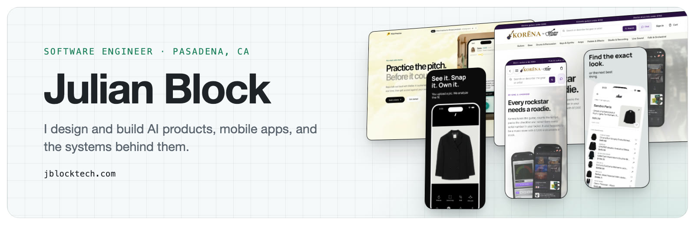
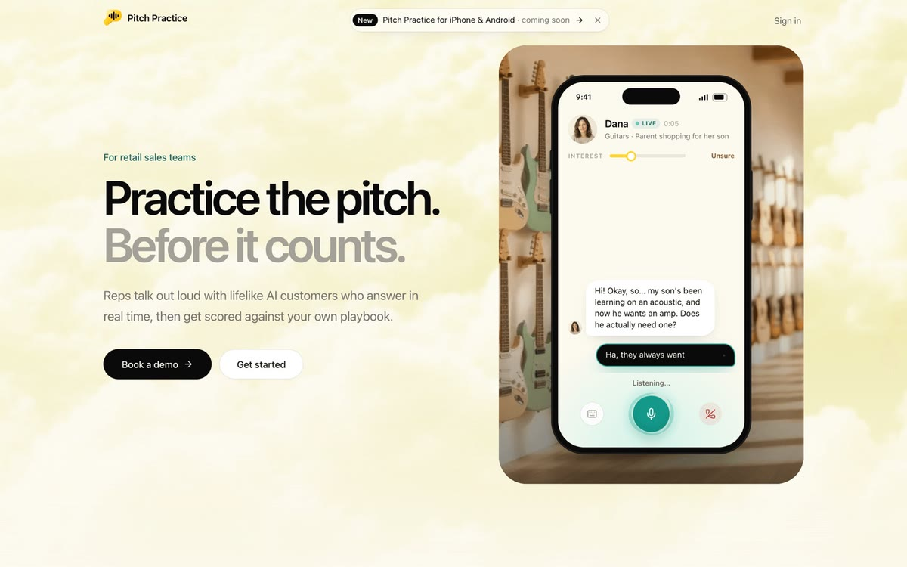
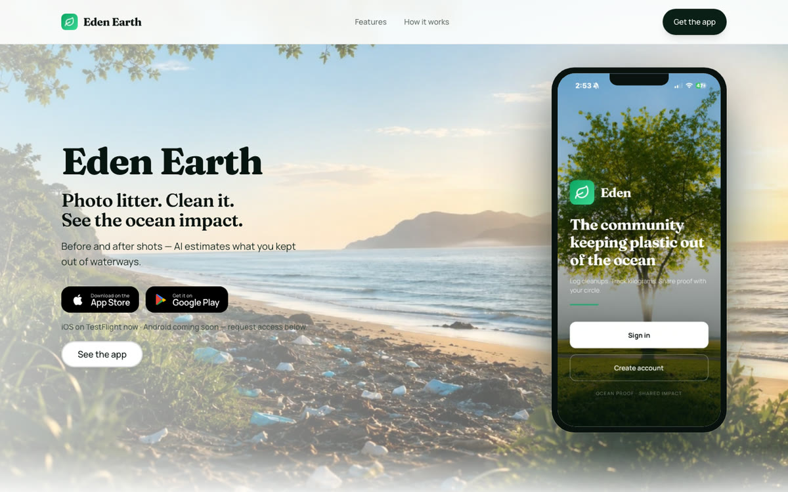
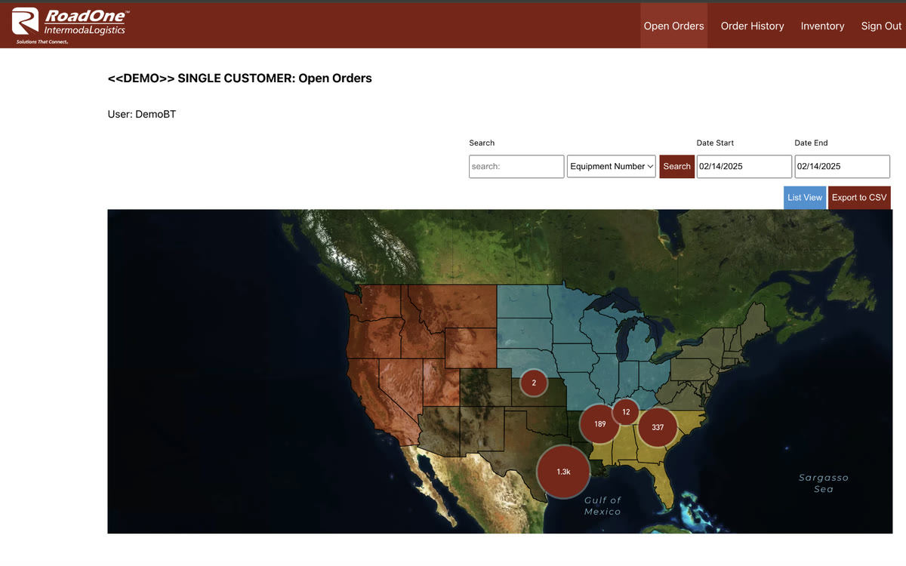
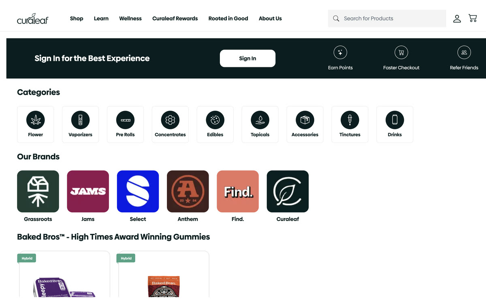

<a href="https://jblocktech.com">
  <picture>
    <source media="(prefers-color-scheme: dark)" srcset="./assets/banner-dark.jpg"/>
    <source media="(prefers-color-scheme: light)" srcset="./assets/banner-light.jpg"/>
    
  </picture>
</a>

  <a href="https://jblocktech.com">jblocktech.com</a> ·
  <a href="mailto:jblock@jblocktech.com">jblock@jblocktech.com</a> ·
  <a href="https://www.linkedin.com/in/julianblock/">LinkedIn</a> ·
  <a href="https://github.com/Julianblock/projects">Project write-ups</a>

The work I enjoy most is where AI turns into something a person can actually use: a customer you can rehearse a pitch with, a photo that becomes a measurement, a dashboard that tells a manager where to look next.

Most of what I've shipped was client work under NDA in logistics, fintech and payments, cannabis and wellness, and media streaming, so the source stays private. The [projects repo](https://github.com/Julianblock/projects) covers each one instead: the problem, what I built, an architecture diagram, and screenshots.

Outside of work I'm a father, a wannabe musician, and a wannabe mathematician.

## Selected work

<table>
  <tr>
    <td width="50%" valign="top">
      
      <h3><a href="https://github.com/Julianblock/projects/tree/main/pitch-practice">Pitch Practice</a></h3>
      
Retail reps practice sales conversations by voice with AI customers and get scored against their company's playbook.

      
Own product · 2026 · Next.js, Expo, Supabase, OpenAI Realtime API

    </td>
    <td width="50%" valign="top">
      
      <h3><a href="https://github.com/Julianblock/projects/tree/main/eden-earth">Eden Earth</a></h3>
      
Before-and-after cleanup photos become an AI estimate of the litter kept out of waterways.

      
Own product · 2025 – present · Expo, Next.js, Supabase, Gemini

    </td>
  </tr>
  <tr>
    <td width="50%" valign="top">
      
      <h3><a href="https://github.com/Julianblock/projects/tree/main/koin-direct">Koin Direct</a></h3>
      
Fund and cash out casino slot machines from your phone over Bluetooth, QR, or player card.

      
Client: Koin Payments · 2024 – 2025 · React Native, Bluetooth LE

    </td>
    <td width="50%" valign="top">
      
      <h3><a href="https://github.com/Julianblock/projects/tree/main/dreamcatcher">Dreamcatcher</a></h3>
      
A dream journal that interprets entries with GPT-4 and links them to earlier dreams through vector search.

      
Own prototype · 2024 – present · Next.js, Flask, Pinecone

    </td>
  </tr>
  <tr>
    <td width="50%" valign="top">
      
      <h3><a href="https://github.com/Julianblock/projects/tree/main/echolink">Echolink</a></h3>
      
Anonymous driver feedback for trucking companies, scored for sentiment and sorted into issues.

      
Client: Ramsey Mediaworks · 2023 – present · React, Flask, GPT-4

    </td>
    <td width="50%" valign="top">
      
      <h3><a href="https://github.com/Julianblock/projects/tree/main/roadone-client-portal">RoadOne Client Portal</a></h3>
      
Intermodal customers track orders, follow their freight on a map, and pay invoices.

      
Client: RoadOne IntermodaLogistics · 2023 – present · React, PHP, Mapbox

    </td>
  </tr>
  <tr>
    <td width="50%" valign="top">
      
      <h3><a href="https://github.com/Julianblock/projects/tree/main/pokergo">PokerGO</a></h3>
      
Live tournament reporting and partner data APIs for World Series of Poker coverage.

      
Client: PokerGO · 2021 – 2022 · Vue.js, Node.js, Strapi

    </td>
    <td width="50%" valign="top">
      
      <h3><a href="https://github.com/Julianblock/projects/tree/main/curaleaf">Curaleaf and Select</a></h3>
      
Storefronts, payments, and analytics for two national cannabis brands across 18+ state subdomains.

      
Client: Curaleaf · 2020 – 2021 · React, Gatsby, Azure Functions

    </td>
  </tr>
</table>

## What I work with

<table>
  <tr><td><b>AI</b></td><td>OpenAI Realtime API, GPT-4, Gemini, Pinecone vector search</td></tr>
  <tr><td><b>Web</b></td><td>TypeScript, React, Next.js, Vue.js, Gatsby</td></tr>
  <tr><td><b>Mobile</b></td><td>React Native, Expo, Bluetooth LE</td></tr>
  <tr><td><b>Backend and data</b></td><td>Node.js, Flask, PHP, Supabase, MySQL, GraphQL, Strapi, Azure Functions</td></tr>
</table>

## Get in touch

If you're working on something where AI, mobile, or messy real-world data meet, I'd like to hear about it: [jblock@jblocktech.com](mailto:jblock@jblocktech.com).
